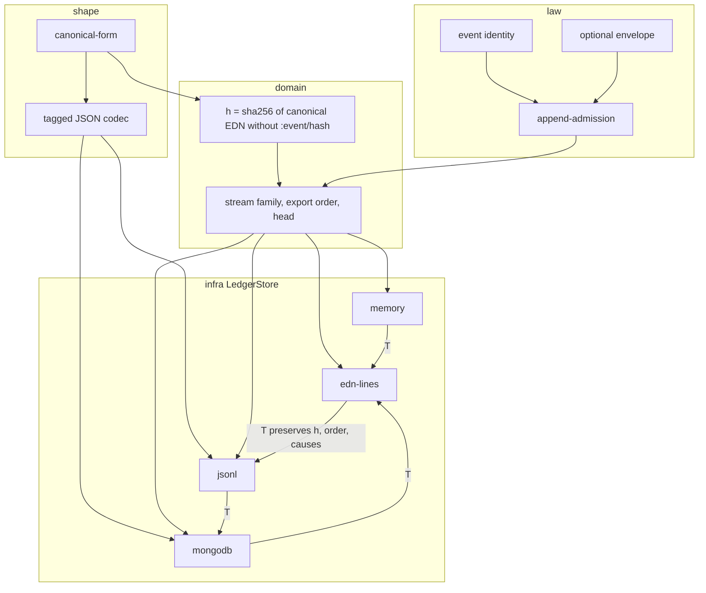

# Ledger store model

This note is the contract for moving a clio ledger between stores. It is the
model the adapters and the tests implement. Schema catalogs, Merkle roots and
filesystem durability are unchanged and are not restated here.

## Objects

**Portable value.** A value on which `clio.shape.canonical/canonical-form` is
defined: `nil`, booleans, Unicode scalar strings, keywords and symbols that
round-trip through EDN, UUIDs, instants in the closed range
`1582-10-15T00:00:00.000Z` … `9999-12-31T23:59:59.999Z` with a standard `#inst`
printing, safe integers in `[-9007199254740991, 9007199254740991]`, and the
other finite IEEE-754 binary64 values. Maps, sets and sequential collections
are portable when their elements are. Ratios, decimals, integers outside the
safe range, NaN, infinities, unpaired UTF-16 surrogates, functions and host
objects are not portable.

**Ev.** A map `e` such that:

- `e` is portable
- `clio.law.event/event-identity-valid?` holds: `:event/id` is a UUID string,
  `:event/stream` is a non-blank string, `:event/seq` is a positive integer,
  `:event/causes` is a vector of distinct UUID strings that does not contain
  `:event/id`
- every *present* optional envelope key has one spelling
  (`clio.law.envelope/fields-valid?`):
  - `:event/type` is a keyword
  - `:event/actor` is a non-blank string
  - `:event/at` is a non-blank string or a portable instant
  - `:event/hash` is 64 lowercase hex digits
  - `:event/body` has no extra spelling rule; it is portable because `e` is

None of those keys is required. An event written with `:event/data`, a string
`:event/at` and no `:event/hash` is an Ev. `:event/data` is not renamed.

**Hash.** Only the top-level envelope slot is excluded. A key named
`:event/hash` nested under `:event/data` or `:event/body` is part of the
preimage.

```text
preimage(e) = canonical-edn(e without the top-level :event/hash key)
h(e)        = sha256-utf8(preimage(e))
```

`canonical-edn` is `pr-str` of `canonical-form`. `sha256-utf8` is the digest
already used for schema roots (`clio.extern.*.crypto/sha256`), lowercase hex.
`h(e)` does not read a stored `:event/hash`, so the definition is not circular.
When the key is present it must equal `h(e)`. `seal` adds the key when it is
absent and refuses a value that disagrees. It does not rewrite a disagreement.

**Ledger `L`.** A finite set of events (a family of streams) such that event
ids are unique and `[stream, seq]` slots are unique. The set may be empty.
Sequences need not be contiguous and causes need not resolve inside `L`. Those
two checks belong to `clio.domain.canonicalize` when a *complete* history is
assembled. A store holds a partition. Law 6 still applies: the order the
events were physically written is not part of `L`.

Two ledgers are equal when they have the same stream ids and, for each stream,
the same events in `:event/seq` order under Clojure `=`.

**Stream order.** Stream ids are sorted by Clojure `compare` (lexicographic on
UTF-16 code units; stream ids are scalar strings). Within a stream, events are
sorted by `:event/seq` ascending. That concatenation is the **export order**.

**Head hash.**

```text
H(⟨⟩)        = sha256-utf8(canonical-edn [:clio.ledger/empty-head])
H(xs · e)    = sha256-utf8(canonical-edn [H(xs), h(e)])
tip(L, s)    = H(events of s in sequence order)
head(L)      = sha256-utf8(canonical-edn {s ↦ tip(L, s)})
```

The map in `head(L)` is keyed by stream id and contains only streams that have
at least one event. Missing sequence numbers are not filled in. `head` is a
function of the stream family, so equal ledgers have equal heads. The empty
ledger's head is the hash of the canonical form of `{}`.

**Store.** An object with the operations below. The adapters in this slice are
`memory` (the reference value), `edn-lines`, `jsonl` and `mongodb`. A later
adapter (sqlite, duckdb, postgres, redis, elasticsearch, opensearch) is another
object of the same shape.

## Morphisms

`append : Store × Ev → Store × Verdict`

The verdict is one of:

| Verdict | Meaning |
| --- | --- |
| `:appendable` | The store returned is the previous store plus `e`. |
| `:already-present` | `e` is `=` to the stored event with the same id. The store is unchanged. |
| `:id-collision` | Same `:event/id`, different map. The store is unchanged. |
| `:stream-slot-conflict` | Same `[stream, seq]`, different event. The store is unchanged. |
| `:rejected` | Identity, envelope, hash or portability failed. The store is unchanged. `:admission/reason` names the failure. |

`:appendable` is reported by the law as the decision *before* the write; the
adapter's return value uses `:appended` once the write has been accepted. The
other three law verdicts are exactly `clio.law.ledger/append-admission`. Identity
is decided before the slot, so an exact retry is `:already-present` rather than
a conflict with itself. Hash and envelope checks run before that law, so a
wrong `:event/hash` is `:rejected`, not an id collision.

`read-range(store, s, from, to)` returns the events of stream `s` whose
`:event/seq` lies in the inclusive interval `[from, to]`, ordered by sequence.
`from` defaults to 1. A missing `to` means there is no upper bound. An empty
interval (including `from > to`) is the empty vector. Bounds that are not
positive integers are refused.

`streams(store)` is the sorted vector of stream ids.

`head-hash(store)` is `head(L)`.

`release(store)` drops host resources. It is idempotent and does not remove
events unless the caller asked a MongoDB store to drop its collection.

**Line morphisms.** These are not the hash preimage. The hash preimage is
canonical EDN of the event. A line is the event itself, so a reader gets the
event back.

```text
edn-line(e)   = pr-event(e) followed by a newline
json-line(e)  = to-json(e) followed by a newline
```

`pr-event` is `pr-str` with printer length, level and pretty-printing cleared,
so a bound `*print-length*` cannot abbreviate a line. Blank lines are ignored
on read. A line that is not one value refuses the read; lines after it are not
returned.

**JSON codec.** `to-json : Portable' → JSON text` and `from-json` its inverse.
`Portable'` is the portable values except records, which `=` does not
identify with the underlying map and which this codec refuses
(`:clio.json/unsupported-value`). Metadata is not encoded. Clojure `=` does
not read it, so a value with metadata still round-trips under `=`, and the
decoded value has none.

Every value is a one-element-or-more JSON array whose head is a string tag.
The carrier uses arrays, strings, safe integers, booleans and null. It does
not use JSON objects or JSON floats. The tags are:

| Tag | JSON after the tag | EDN |
| --- | --- | --- |
| `nil` | nothing | `nil` |
| `bool` | boolean | boolean |
| `string` | string | string |
| `keyword` | namespace-or-null, name | keyword |
| `symbol` | namespace-or-null, name | symbol |
| `uuid` | lowercase RFC-4122 text | UUID |
| `inst` | decimal millisecond digits | instant |
| `integer` | canonical decimal digits | safe integer |
| `real` | sign ∈ {1, −1}, mantissa digits, binary exponent | finite double |
| `vector` | array of tagged values | vector |
| `set` | array of tagged values | set |
| `map` | array of `[key, value]` pairs | map |

Set elements and map entries are sorted by canonical text, then by a type rank,
so the JSON text does not depend on hash iteration order. An integer and the
JVM double of the same magnitude share a canonical text and are split by that
rank. Duplicate set elements and duplicate map keys are refused
(`:clio.json/duplicate-element`, `:clio.json/duplicate-key`), not dropped.
A tag of the wrong length, an unknown tag, a non-canonical integer spelling
(`"01"`, `"-0"`) and an uppercase UUID are refused. JSON text that is not one
complete carrier value is refused (`:clio.json/invalid-text`), including a
float, an object, an integer outside the safe range, and any trailing
characters. The reader does not return a prefix.

`real` uses `finite-real-components` / `compose-real`. The exponent is an
integer in `[-1126, 971]`, the range of that decomposition for a finite
binary64 value. A triple outside that range, or one that does not reproduce
itself, is refused before reconstruction, not rounded and not looped over.
Zero, including `-0.0`, is the triple `[1, "0", 0]` because `(= -0.0 0.0)`.

Sequential values that are not vectors are encoded as `vector`. Clojure `=`
compares sequential collections by contents, so a list round-trips under `=`.
The decoded collection is a vector.

**Number identity.** On the JVM, `1` and `1.0` are not `=`, and the codec
preserves that: `1` is an `integer` tag and `1.0` is a `real` tag.
`canonical-form` still identifies them, which is unchanged. On ClojureScript,
`integer?` is true for an integer-valued double, so `1.0` is encoded as an
integer; `(= 1.0 1)` already holds there. Neither path shortens a significand.

**Adapters.**

```text
F_s : Ledger → Store_s
```

`F_s(L)` appends export-order events of `L` onto an empty store of kind `s`.

```text
F_s⁻¹ : Store_s → Ledger
```

`F_s⁻¹` is `streams` plus `read-range` over every stream, i.e. `all-events`.

```text
T_{s→t} = F_t ∘ F_s⁻¹
```

`transfer` is `T`. It appends in export order, one event at a time. A verdict
other than `:appended` or `:already-present` aborts the transfer. The events
already accepted stay. `append` is not a multi-event commit, and neither is
`import-ledger` or `import-jsonl`.

**Commit boundary.** There is no batch transaction in this protocol. A caller
that must recover a decision, a receipt, and an outbox as one committed
operation cannot get that by calling `append` three times, and this protocol
will not grow a second store interface to imply it. That caller uses a
transaction the specific store already has, or its own committed-operation
envelope, qualified on its own. Head-hash equality is equality of the stream
family. It is not an authorization decision and it is not a proof that
`:event/causes` resolve inside the ledger. Causal closure stays in
`canonicalize`.

**Node MongoDB blocking.** The Node adapter waits on `Atomics.wait` in the
calling thread, up to 8 seconds while the worker boots and up to 20 seconds
per command. It must not run on a request-serving event loop. A process that
shares that loop has to put its own asynchronous boundary in front of this
adapter. This repository does not provide that boundary, and a store-return
test is not a liveness probe for the surrounding service.

**Projection.** `clio.domain.projection/state` is `foldl step`. For a pure
`step`,

```text
project(L ++ L') = foldl step (project L) L'
```

The store does not add a second projection type. Graph and mailbox folds are
later `step` functions of this same fold.

## Laws

1. **Admission.** `append` implements the table above. Exact retries do not
   grow the ledger. Collisions, hash failures and non-portable payloads do not
   write.

2. **Hash preservation.** For every event `e` in `L`, `h(e) = h(e')` where
   `e'` is the event with the same id in `T(L)`. The stored `:event/hash`
   key, when present, is part of `e'` under `=`, so it moves with the event.

3. **Order preservation.** For each stream, the sequence of `:event/id` ordered
   by `:event/seq` is the same in `L` and in `T(L)`.

4. **Causes preservation.** `:event/causes` of each event is the same in `L`
   and in `T(L)`. Transfer does not re-check that those ids resolve; it copies
   the vector.

5. **Store round-trip.** `F_s⁻¹(F_s(L)) = L` for each adapter `s`, including
   `s → s` onto a fresh store. Equality is the stream family, not file bytes
   and not MongoDB's `_id` index.

6. **Transfer composition.** `T_{t→u} ∘ T_{s→t} = T_{s→u}`.
   This follows from law 5: `F_t⁻¹ ∘ F_t` is the identity on ledgers, so the
   middle adapter cancels. The tests check the identity on every ordered pair
   and check the composition on ordered triples directly.

7. **Head invariance.** `head(T(L)) = head(L)`.

8. **Codec round-trip.** For every `x` in `Portable'`,
   `from-json(to-json(x)) = x` under Clojure `=`, and
   `canonical-form(from-json(to-json(x))) = canonical-form(x)`.
   EDN lines satisfy `parse-edn(emit-edn(export(L))) = export(L)`.
   JSON lines satisfy the same with `parse-jsonl` / `emit-jsonl`.
   A value outside `Portable'` raises and yields no value.

9. **Projection commutation.** For a pure `step`,
   `project(F_s⁻¹(x)) = project(F_t⁻¹(T_{s→t}(x)))`.
   The fold never sees which adapter held the events.

10. **Canonicalize commutation.** `canonicalize` depends on the event multiset,
    not on physical order. Therefore it is defined on `L` exactly when it is
    defined on `T(L)`, and the results are equal. A partition that fails
    canonicalization for a missing parent or a sequence gap fails the same way
    after transfer. The store does not repair that.

11. **No truncation.** The codec and the MongoDB sequence index refuse values
    they cannot represent. They do not narrow an integer, round a double,
    drop a duplicate key, or return a prefix of a bad document.

## MongoDB

One document per event:

```text
{_id: event-id, stream, seq, event: to-json(e)}
```

`_id` and `[stream, seq]` are unique. `append-admission` only consults the
event with the same id and the event with the same slot, so the adapter reads
those two documents rather than the whole collection. A duplicate-key error
from a concurrent insert is re-read and returned as the law's verdict.

`seq` is stored as an int64 for the index. A positive sequence that `parse-long`
cannot name is refused (`:clio.mongo/seq-out-of-range`) and is not written.
The JSON document is still the authority for the events that were written.
`read-range` queries that index and then applies the same inclusive bounds as
every other adapter. `head-hash` reads the collection and uses the definition
above; it does not trust a cached tip.

The JVM adapter calls the sync driver and does not let a `MongoClient` leave
`clio.extern.jvm.mongo`. The Node adapter loads the `mongodb` package inside a
worker thread and blocks with `Atomics.wait`, so the protocol stays
synchronous. Driver objects do not cross into `clio.infra`. If the driver is
not installed, or the server does not answer within the selection timeout, open
reports `:clio.mongo/driver-missing` or `:clio.mongo/unavailable` and the
transfer suite skips those pairs. A skipped pair is not reported as a pass of
the law; the pairs that did run are the ones whose stores were opened.

## Diagram


